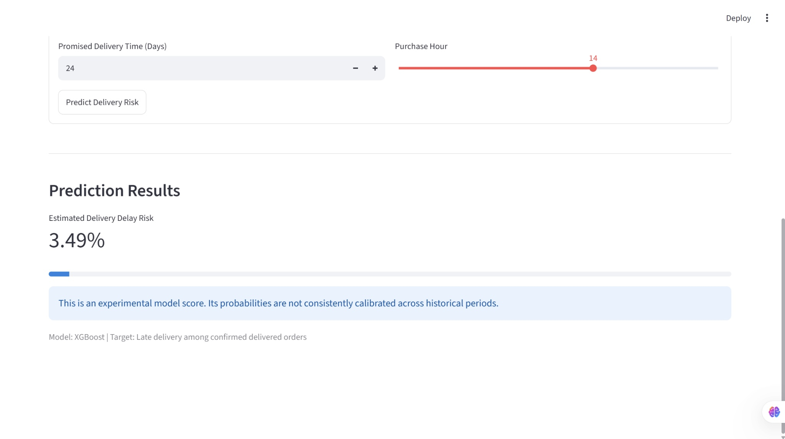
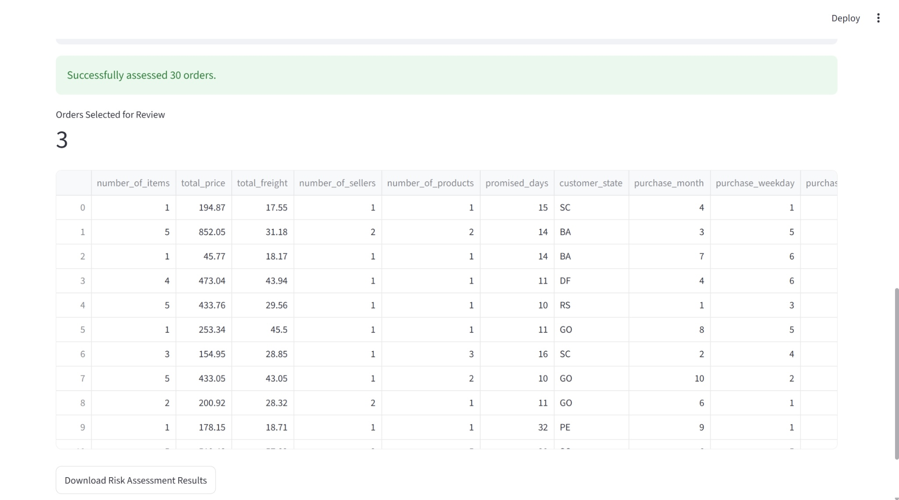
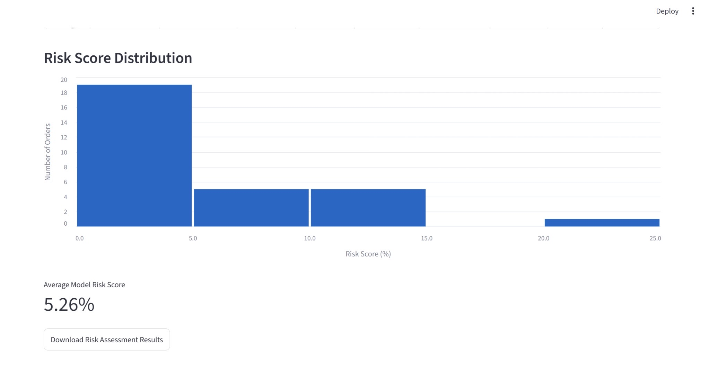

# AI Delivery Risk Intelligence

**A research and engineering portfolio project for delivery-risk ranking, probability-calibration diagnostics, and operational decision support.**

[](https://github.com/DR-ZohrehKaheh/ai-delivery-risk-intelligence/actions/workflows/tests.yml)
[](https://doi.org/10.5281/zenodo.23324488)

Developed by [DR-ZohrehKaheh](https://github.com/DR-ZohrehKaheh). Built with Python, pandas, scikit-learn, XGBoost, Streamlit, Altair, and unit tests.

> **Research demonstration only.** The project uses historical Brazilian e-commerce data and has not been validated for live commercial decisions. Model scores are not reliably calibrated real-world delivery-delay probabilities.

## Dashboard preview

The screenshots below show an **earlier locally run Streamlit prototype**. They document the UI and are not evidence of live deployment. The batch examples use **30 synthetic orders**; risk scores are experimental and are not consistently calibrated across historical periods.

### 1. Single-order prediction



### 2. Batch risk assessment



### 3. Risk score distribution



The screenshots were captured during development; wording and arrangement in the current application may differ. For technical details, see [screenshot documentation](docs/README.md).

## What it does

- Constructs order-level features from purchases, customers, and line items.
- Compares baseline, logistic regression, random forest, and XGBoost approaches.
- Uses chronological training, calibration, validation, and retrospective test cohorts, with outcome-availability checks.
- Measures discrimination, average precision, Brier score, and top-10% review prioritization.
- Examines calibration instability and approximate bootstrap uncertainty of *performance metrics*.
- Offers a Streamlit dashboard for single-order scoring, CSV batch processing, adjustable review capacity, ranked output, and a risk-score histogram.
- Supports independent model training and automated tests.

## Pipeline at a glance

```text
Kaggle Olist CSVs (download separately)
    └─ Order-level joins and purchase-time features
          └─ Chronological training + validation
                └─ XGBoost pipeline → local joblib model
                      └─ Streamlit single-order and CSV batch scoring

Separate retrospective analyses:
  Calibration diagnostics · Test evaluation · Bootstrap performance intervals
```

The dashboard is a **local, research-only demonstration**, not a deployed public application. Its Python model must be regenerated from the licensed input data before launch.

## Data and ethics

Dataset: [Brazilian E-Commerce Public Dataset by Olist](https://www.kaggle.com/datasets/olistbr/brazilian-ecommerce), with transactions from 2016–2018. The source identifies its license as **CC BY-NC-SA 4.0**. Download from Kaggle; raw CSV files are not redistributed here. Check licensing before commercial use.

The target is **late delivery among confirmed delivered orders**. Canceled, unresolved, or missing-delivery-date orders are excluded; these historical results must not be generalized to all placed orders. Records near the end of the extract may be right-censored, and filtering observed deliveries introduces possible selection bias.

## Results recorded in development

Validation: **20,623** confirmed delivered orders; **12.86%** observed late deliveries.

| Model | ROC-AUC | Average precision | Brier score |
|---|---:|---:|---:|
| Dummy | 0.5000 | 0.1286 | 0.1205 |
| Logistic regression | 0.5745 | 0.1638 | 0.1165 |
| Random forest | 0.6259 | 0.1938 | 0.1193 |
| XGBoost | **0.6377** | **0.2031** | 0.1170 |

Retrospective test: **12,507** confirmed delivered orders; **4.81%** observed late deliveries.

| Model | ROC-AUC | Average precision | Brier | Precision@10% | Lift@10% |
|---|---:|---:|---:|---:|---:|
| Original XGBoost | 0.6917 | 0.0854 | **0.0449** | 0.0871 | 1.8132 |
| Sigmoid-calibrated XGBoost | 0.6917 | 0.0854 | 0.0478 | 0.0871 | 1.8132 |

Calibration lowered validation Brier error but increased retrospective-test Brier error. Accordingly the dashboard exposes an **experimental risk score**, not a calibrated probability.

Approximate 95% order-level percentile-bootstrap intervals (1,000 resamples on the retrospective test):

| Metric | Estimate | 95% interval |
|---|---:|---:|
| ROC-AUC | 0.6917 | 0.6720–0.7117 |
| Average precision | 0.0854 | 0.0764–0.0970 |
| Brier score | 0.0449 | 0.0416–0.0482 |
| Precision@10% | 0.0871 | 0.0719–0.1031 |

These intervals do **not** capture future distribution shift, seller clustering, model-training variability, or uncertainty for an individual prediction. Validation and test results have been viewed during development, so this is not a new untouched holdout estimate.

## Reproduce (Windows / PowerShell)

Requires Python 3.12. Download the Olist data from Kaggle, then place the following CSV files under `data/raw/`: `olist_orders_dataset.csv`, `olist_customers_dataset.csv`, and `olist_order_items_dataset.csv`.

```powershell
py -3.12 -m venv .venv
.\.venv\Scripts\python.exe -m pip install -r requirements.txt
.\.venv\Scripts\python.exe -m unittest discover -s tests -v
.\.venv\Scripts\python.exe src/train.py
.\.venv\Scripts\python.exe -m streamlit run app.py
```

The training script regenerates `artifacts/xgboost_reproduced.joblib`. Serialized models are deliberately excluded from this repository: **never unpickle untrusted model files**. Versions and results can vary slightly across environments.

### Batch CSV schema

```text
number_of_items,total_price,total_freight,number_of_sellers,number_of_products,promised_days,customer_state,purchase_month,purchase_weekday,purchase_hour
```

- Brazilian customer state code, price and freight in BRL.
- Weekday: Monday=0, Sunday=6; hour: 0–23.
- Downloaded batch results escape formula-like text cells and headers for spreadsheet safety; model scores are unchanged.
- Review priority means highest model scores in the *uploaded batch*, not verified benefit from an intervention.

## Project organization

- `app.py`: Streamlit local dashboard and batch assessment
- `src/train.py`: feature construction, temporal cohort selection, XGBoost training
- `src/input_validation.py`: validated batch input schema
- `tests/test_model.py`: dataset-independent unit tests
- `01_ml_environment_test.ipynb` to `04_temporal_validation.ipynb`: exploratory notebooks and research diagnostics
- `artifacts/`: aggregate test results, bootstrap confidence-interval summaries and methodology metadata (full bootstrap resamples are not published)
- `data/README.md`: dataset acquisition instructions
- `.github/workflows/tests.yml`: GitHub Actions tests

The independent training script reproduces training and validation only; calibration, retrospective test and bootstrap research were executed separately in the historical notebook. Excluded datasets and saved joblib files are **not** required to run the dataset-independent unit tests.

## Current verification

A [17 October 2026 audit](docs/VALIDATION.md) reran training and all notebook code cells on separately obtained Olist data, passed six tests and checked Streamlit single-order scoring. The rerun did **not exactly reproduce the earlier metric tables**; measured differences and the tested scope are documented in that record. Batch CSV downloads now escape spreadsheet-formula-like text.

## Next research and engineering steps

- Time-point-consistent outcome snapshots and sensitivity analysis for unobserved delivery outcomes
- Seller-clustered/time-block bootstrap, monitoring temporal drift, and calibration diagnostics
- Automated integration tests with licensed data, model cards, and independent prospective validation
- A genuinely prospective study before any operational deployment

## Citation and DOI

Version **0.1.0** is preserved in [Zenodo](https://zenodo.org/records/23324488) and corresponds to the [GitHub release](https://github.com/DR-ZohrehKaheh/ai-delivery-risk-intelligence/releases/tag/v0.1.0).

- **Version DOI:** [10.5281/zenodo.23324488](https://doi.org/10.5281/zenodo.23324488) — cite this for the specific archived software and results.
- **Concept DOI:** [10.5281/zenodo.23324487](https://doi.org/10.5281/zenodo.23324487) — identifies the software across its archived versions and resolves to the latest version.

> Kaheh, Z. (2026). *AI Delivery Risk Intelligence: E-commerce Delivery Risk Ranking and Uncertainty Analysis* (Version 0.1.0) [Computer software]. Zenodo. https://doi.org/10.5281/zenodo.23324488

Use GitHub's **Cite this repository** button, [CITATION.cff](CITATION.cff), or [CITATION.bib](CITATION.bib) to copy a software citation. Please cite the version you actually consulted.

The archive preserves release commit `da5ce573d88e74f19db96f6b37926faff6fd82ef`. Citation metadata were added to `main` after DOI registration; the archived release remains unchanged. See [archiving details](docs/ARCHIVING.md).

Citation does not grant reuse permission; see [RIGHTS.md](RIGHTS.md). This software citation is separate from attribution of the [original Olist dataset](https://www.kaggle.com/datasets/olistbr/brazilian-ecommerce), whose licence restrictions also apply.

## Permissions for source code

Copyright © 2026 Zohreh Kaheh. The repository is public for technical review and scholarly citation; **no general software reuse licence is granted**. Uses requiring the rights holder's permission must be authorised separately, subject to applicable law and platform terms. See [RIGHTS.md](RIGHTS.md) for the full rights statement and permission requests. Citation does not itself grant reuse permission.

The Olist dataset's CC BY-NC-SA 4.0 terms are separate from the source-code rights. Raw data and generated model binaries are excluded.

## Documentation

- [Scikit-learn: common pitfalls](https://scikit-learn.org/stable/common_pitfalls.html)
- [Scikit-learn: calibration](https://scikit-learn.org/stable/modules/calibration.html)
- [Scikit-learn: model persistence](https://scikit-learn.org/stable/model_persistence.html)
- [XGBoost](https://xgboost.readthedocs.io/en/stable/)
- [Streamlit](https://docs.streamlit.io/)
